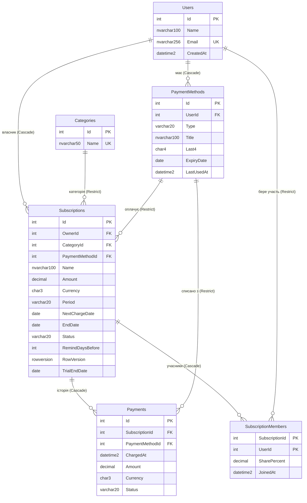

# SubTracker — менеджер підписок і регулярних платежів

Лабораторна робота № 2 з дисципліни «Конструювання програмного забезпечення»,
варіант 10. Модуль доступу до даних SQL Server через **ADO.NET** (Microsoft.Data.SqlClient)
і **Entity Framework Core 10** (Code First, міграції, Database First / scaffolding).

Платформа: .NET 10 (net10.0), C# 14, EF Core 10.0.13, SQL Server Express LocalDB.

## Структура рішення

```
SubTracker/
├── .config/dotnet-tools.json      локальний інструмент dotnet-ef 10.0.13
├── SubTracker.slnx
├── docs/migrations.sql            ідемпотентний SQL-скрипт обох міграцій
├── scripts/                       допоміжні .cmd (скидання БД, прогін демо, scaffold)
└── src/
    ├── SubTracker.Domain/         сутності, enum-и, BillingCalculator — без залежностей
    ├── SubTracker.DB/             EF Core: DbContext, Fluent API, Migrations, seeding, сервіси, LINQ
    ├── SubTracker.AdoNet/         ADO.NET: CRUD, JOIN, GROUP BY, транзакція
    ├── SubTracker.Console/        точка входу: конфігурація, DI, меню демонстрації
    └── SubTracker.Scaffolded/     результат reverse engineering (dotnet ef dbcontext scaffold)
```

Залежності між проєктами: `Console → DB → Domain`, `Console → AdoNet → Domain`.
`Scaffolded` ні від кого не залежить і ніким не використовується.

## ER-модель



6 таблиць, 8 зовнішніх ключів, зв'язок «багато-до-багатьох» Users ↔ Subscriptions через явну
сутність `SubscriptionMembers` зі складеним ключем. Унікальні обмеження: `Users.Email`, `Categories.Name`,
`(Subscriptions.OwnerId, Name)`. Concurrency token: `Subscriptions.RowVersion`.

## Запуск

1. Рядок підключення в user secrets проєкту `SubTracker.Console`
   (правий клік → Manage User Secrets):
   ```json
   { "ConnectionStrings": { "SubTrackerDb": "Server=(localdb)\\MSSQLLocalDB;Database=SubTrackerDb;Trusted_Connection=True;TrustServerCertificate=True" } }
   ```
2. Інструмент і база:
   ```
   dotnet tool restore
   dotnet ef database update --project src/SubTracker.DB --startup-project src/SubTracker.Console
   ```
   Міграції створюють схему, `HasData` заповнює Users і Categories, `UseSeeding` — решту таблиць.
3. Запуск: `SubTracker.Console` → F5. Меню з 13 пунктами демонстрації.

Скинути базу до початкового стану: `scripts\db-reset.cmd`.
Прогнати всі пункти меню автоматично з виводом у `logs\`: `scripts\demo-all.cmd`.

## Команди dotnet ef, які використовувались

```
dotnet ef migrations add InitialCreate --project src/SubTracker.DB --startup-project src/SubTracker.Console --output-dir Migrations
dotnet ef database update            --project src/SubTracker.DB --startup-project src/SubTracker.Console
dotnet ef migrations add AddTrialEndDateAndStatusIndex --project src/SubTracker.DB --startup-project src/SubTracker.Console
dotnet ef database update            --project src/SubTracker.DB --startup-project src/SubTracker.Console
dotnet ef migrations script --idempotent -o docs/migrations.sql --project src/SubTracker.DB --startup-project src/SubTracker.Console
dotnet ef dbcontext scaffold "Server=(localdb)\MSSQLLocalDB;Database=SubTrackerDb;Trusted_Connection=True;TrustServerCertificate=True" Microsoft.EntityFrameworkCore.SqlServer --project src/SubTracker.Scaffolded --startup-project src/SubTracker.Scaffolded --context ScaffoldedDbContext --context-dir . --output-dir Entities --namespace SubTracker.Scaffolded.Entities --context-namespace SubTracker.Scaffolded --no-onconfiguring --force
```

## Відповідність пунктам ходу роботи

| № | Вимога | Де реалізовано |
|---|---|---|
| 1 | ER-модель, ≥5 таблиць, ≥4 FK, 1:N, M:N, unique, concurrency token | `Domain/Entities`, схема вище |
| 2 | Code First, типи, довжини, precision, FK, delete behavior, індекси, перша міграція | `DB/Configurations`, `DB/Migrations/*_InitialCreate` |
| 3 | Тестові дані: HasData + UseSeeding/UseAsyncSeeding | `DB/Seeding`, `DB/SubTrackerDbOptions.cs` |
| 4 | ADO.NET CRUD двох пов'язаних сутностей, async, CancellationToken, параметри, SqlDataReader | `AdoNet/Repositories` |
| 5 | JOIN 4 таблиць + GROUP BY з COUNT/SUM/AVG/MAX/MIN | `AdoNet/Reports/ReportQueries.cs` |
| 6 | ADO.NET-транзакція на 3 таблиці, Commit і Rollback | `AdoNet/Transactions/ChargeTransactionService.cs` |
| 7 | DbContext + IEntityTypeConfiguration, composite key, unique index, свідомий DeleteBehavior | `DB/SubTrackerDbContext.cs`, `DB/Configurations` |
| 8 | EF CRUD 3 сутностей + бізнес-операція з entity graph у транзакції | `DB/Services` (`FamilyPlanService`) |
| 9 | ≥6 LINQ-запитів, AsNoTracking | `DB/Queries/SubscriptionQueries.cs` |
| 10 | Optimistic concurrency, DbUpdateConcurrencyException на двох DbContext | `Console/Demos/ConcurrencyDemo.cs` |
| 11 | Друга міграція, SQL-скрипт | `DB/Migrations/*_AddTrialEndDateAndStatusIndex`, `docs/migrations.sql` |
| 12 | Reverse engineering з `--no-onconfiguring` | `src/SubTracker.Scaffolded` |
| 13 | SQL через ToQueryString і логування, перевірка N+1 | `Console/Demos/SqlDiagnosticsDemo.cs` |
| 14 | Демонстрація | `Console/Demos/DemoMenu.cs` |
